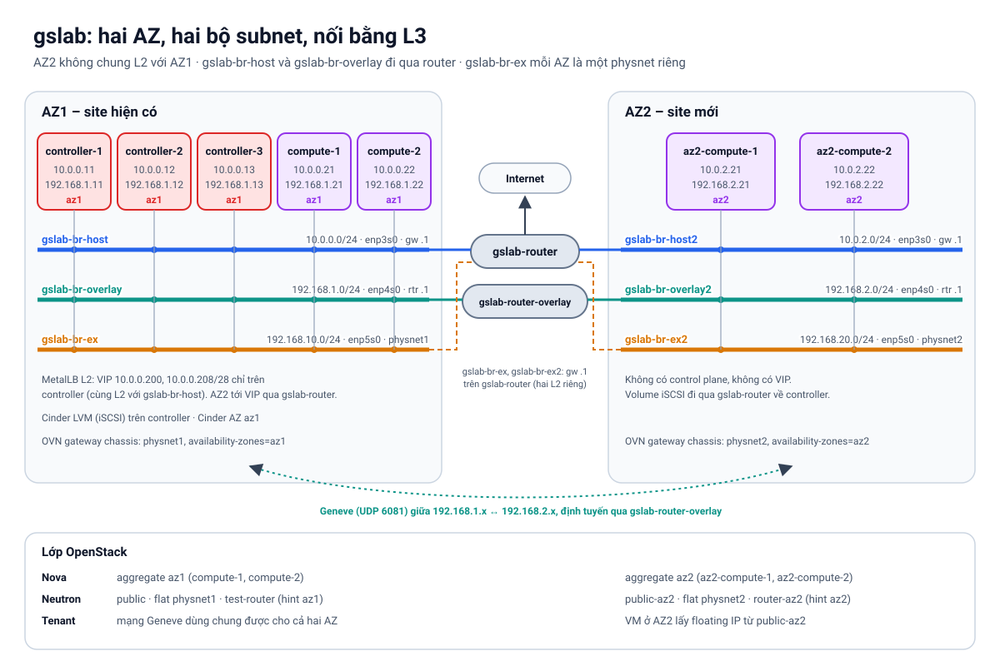

Ở [Phần 8](/posts/genestack-09-add-compute-node/), compute node mới nằm chung mạng với các node cũ: cùng `gslab-br-host`, cùng `gslab-br-overlay`, cùng `gslab-br-ex`. Ngoài thực tế, site mới (một rack khác, một phòng máy khác, một toà nhà khác) hiếm khi được kéo chung L2 với site cũ. Nó có dải IP riêng và nói chuyện với site cũ **qua router**.

Bài này dựng tình huống đó trên lab: thêm **AZ2** gồm hai compute node nằm trong ba mạng mới `gslab-br-host2`, `gslab-br-overlay2`, `gslab-br-ex2`. `gslab-br-host2` và `gslab-br-overlay2` nối với `gslab-br-host` và `gslab-br-overlay` cũ qua router. Sau đó cấu hình Kubernetes, OVN, Nova và Neutron để người dùng chọn được `--availability-zone az2`.

Lab dùng `release-2026.2.0.2` (OpenStack 2025.1). Các điểm khác biệt so với mặc định đều được đối chiếu với mã nguồn Genestack, kube-ovn v1.15 và Neutron/Nova đang chạy trên lab. Bước 1–2 (hạ tầng và kết nối underlay) đã chạy trên gslab. **Các bước từ 3 trở đi chưa được chạy đầu–cuối**, nên những chỗ còn là suy luận từ mã nguồn, chưa kiểm chứng, đều được ghi rõ.



## Cái gì cần L2, cái gì chỉ cần L3

Trước khi gõ lệnh, cần biết thành phần nào của Genestack chịu được việc node nằm ở subnet khác, và thành phần nào không:

| Thành phần | Cần gì giữa hai site | Ở AZ2 |
|---|---|---|
| Kubernetes (kubelet → API, etcd) | L3 | kubelet gọi API `10.0.0.11–13:6443` qua router. AZ2 không có control plane |
| Tunnel Geneve của kube-ovn | L3, cộng route tới subnet overlay bên kia | Encap IP là IP trên `enp4s0`, tức `192.168.2.x` |
| OVN của Neutron | Như trên | Genestack dùng chung OVN của kube-ovn: encap IP của chassis chính là IP overlay của node (kiểm tra bằng `kubectl ko sbctl list encap`: `192.168.1.11`… với AZ1) |
| VIP của MetalLB (chế độ L2) | **L2** | Không announce được từ AZ2. Giữ VIP trên controller ở AZ1, AZ2 tới VIP qua router |
| Mạng provider của Neutron (flat `physnet1`) | **L2** | Không kéo sang AZ2 được. AZ2 có mạng provider riêng, đặt tên `physnet2` |
| iSCSI của Cinder LVM | L3 | Compute ở AZ2 nối tới target trên controller qua router |
| Live migration | L3 | Nova không cho chuyển VM giữa hai AZ. Migrate trong nội bộ AZ2 vẫn bình thường |

Hai dòng in đậm quyết định thiết kế: VIP chỉ sống ở AZ1, và mỗi AZ có một mạng external riêng.

### Địa chỉ trong lab

| Network | AZ1 | AZ2 | Nối nhau qua |
|---|---|---|---|
| Quản trị | `gslab-br-host` 10.0.0.0/24, gw `.1` | `gslab-br-host2` 10.0.2.0/24, gw `.1` | `gslab-router` (router của lab, Phần 2 gọi là `router-1`) |
| Overlay | `gslab-br-overlay` 192.168.1.0/24 | `gslab-br-overlay2` 192.168.2.0/24 | `gslab-router-overlay` (mới), route tĩnh qua DHCP |
| Provider | `gslab-br-ex` 192.168.10.0/24 (`physnet1`) | `gslab-br-ex2` 192.168.20.0/24 (`physnet2`) | Không bridge. Mỗi bên có gateway `.1` riêng |

| Node | gslab-br-host2 | gslab-br-overlay2 | gslab-br-ex2 |
|---|---|---|---|
| `openstack-az2-compute-1` | 10.0.2.21 | 192.168.2.21 | `enp5s0`, không IP |
| `openstack-az2-compute-2` | 10.0.2.22 | 192.168.2.22 | `enp5s0`, không IP |

Dùng **hai** compute cho AZ2 để Masakari có chỗ evacuate VM trong cùng AZ (bước 8).

Các lệnh `os` dưới đây chạy trên deployer, như ở các bài trước:

```bash
os() { kubectl -n openstack exec -i openstack-admin-client -- openstack "$@"; }
```

## Bước 1 – Hạ tầng của AZ2

Các lệnh trong bước này chạy với `openstack` CLI trỏ tới **cloud bên dưới** (Rackspace Flex DFW3 của gslab), như ở Phần 2. Tên tài nguyên theo quy ước của gslab: network và router có tiền tố `gslab-`, security group của các node là `default`.

### Ba network mới

```bash
# gslab-br-host2: quản trị, gateway là gslab-router, chung đường ra Internet với gslab-br-host
openstack network create gslab-br-host2
openstack subnet create gslab-br-host2-subnet --network gslab-br-host2 \
  --subnet-range 10.0.2.0/24 --gateway 10.0.2.1 \
  --allocation-pool start=10.0.2.30,end=10.0.2.199 \
  --dns-nameserver 1.1.1.1 --dns-nameserver 8.8.8.8
openstack router add subnet gslab-router gslab-br-host2-subnet

# gslab-br-overlay2: tunnel, tắt port security, không gateway mặc định
openstack network create gslab-br-overlay2 --disable-port-security
openstack subnet create gslab-br-overlay2-subnet --network gslab-br-overlay2 \
  --subnet-range 192.168.2.0/24 --gateway none \
  --allocation-pool start=192.168.2.30,end=192.168.2.199

# gslab-br-ex2: provider của AZ2, không DHCP
openstack network create gslab-br-ex2 --disable-port-security
openstack subnet create gslab-br-ex2-subnet --network gslab-br-ex2 \
  --subnet-range 192.168.20.0/24 --gateway 192.168.20.1 --no-dhcp
```

Như `gslab-br-host` và `gslab-br-overlay`, dải `.2–.29` để ngoài allocation pool, dành cho IP cố định của node (`.21`, `.22`) và router (`.1`).

Trên gslab, `gslab-br-ex` được gắn vào `gslab-router` (gateway `192.168.10.1`) để floating IP và SNAT của OpenStack bên trong ra được Internet (Phần 11). Làm tương tự cho `gslab-br-ex2`, và mở security group `default` cho dải mới như rule `gslab: br-ex` đang có cho `192.168.10.0/24`:

```bash
openstack router add subnet gslab-router gslab-br-ex2-subnet
openstack security group rule create default --ingress --ethertype IPv4 --protocol any \
  --remote-ip 192.168.20.0/24 --description "gslab: br-ex2"
```

### Router cho overlay

Subnet overlay của Phần 2 có `--gateway none`. Đây là chủ ý: node chỉ nên có **một** default route, qua `gslab-br-host`. Giữ nguyên điều đó, và chỉ thêm **route cụ thể** tới subnet overlay bên kia.

Tạo một router riêng, không có external gateway, đặt interface bằng port có IP cố định:

```bash
openstack router create gslab-router-overlay

openstack port create rtr-overlay-az1 --network gslab-br-overlay \
  --fixed-ip subnet=gslab-br-overlay-subnet,ip-address=192.168.1.1
openstack port create rtr-overlay-az2 --network gslab-br-overlay2 \
  --fixed-ip subnet=gslab-br-overlay2-subnet,ip-address=192.168.2.1
openstack router add port gslab-router-overlay rtr-overlay-az1
openstack router add port gslab-router-overlay rtr-overlay-az2
```

`192.168.1.1` và `192.168.2.1` nằm ngoài allocation pool nên chắc chắn còn trống.

Đẩy route xuống node bằng **host route** của subnet. Neutron gửi chúng qua DHCP option 121, nên không phải sửa netplan trên từng node:

```bash
openstack subnet set gslab-br-overlay-subnet \
  --host-route destination=192.168.2.0/24,gateway=192.168.1.1
openstack subnet set gslab-br-overlay2-subnet \
  --host-route destination=192.168.1.0/24,gateway=192.168.2.1
```

Tách overlay ra router riêng mô phỏng mạng thật: traffic tunnel đi trên fabric riêng, không chung đường với traffic quản trị và không có đường ra Internet.

> **Trên máy vật lý** không có DHCP của Neutron. Khai báo route tĩnh trong netplan của interface overlay, ví dụ trên node AZ1:
>
> ```yaml
> network:
>   version: 2
>   ethernets:
>     enp4s0:
>       addresses: [192.168.1.11/24]
>       routes:
>         - to: 192.168.2.0/24
>           via: 192.168.1.1
> ```

### Port và máy ảo

Tạo port theo đúng thứ tự `host`, `overlay`, `ex` như các node đang có của gslab, để tên NIC trên node mới vẫn là `enp3s0`, `enp4s0`, `enp5s0`. Port `gslab-br-host2` **không cần** allowed-address-pairs, vì node AZ2 không bao giờ giữ VIP.

```bash
FLAVOR=gp.5.8.32                      # 8 vCPU · 32 GB, như compute AZ1 của gslab
IMAGE="Ubuntu 24.04"
KEY=sapd
USER_DATA=~/.genestack-lab/gslab/user-data.yaml

for spec in "az2-compute-1 10.0.2.21 192.168.2.21" "az2-compute-2 10.0.2.22 192.168.2.22"; do
  read -r n ip ov <<<"$spec"
  openstack port create "$n-host" --network gslab-br-host2 --security-group default \
    --fixed-ip subnet=gslab-br-host2-subnet,ip-address=$ip
  openstack port create "$n-overlay" --network gslab-br-overlay2 \
    --fixed-ip subnet=gslab-br-overlay2-subnet,ip-address=$ov
  openstack port create "$n-ex" --network gslab-br-ex2 --no-fixed-ip

  openstack server create "openstack-$n" --flavor "$FLAVOR" --image "$IMAGE" --key-name "$KEY" \
    --user-data "$USER_DATA" --property lab=gslab --property role=compute \
    --port "$n-host" --port "$n-overlay" --port "$n-ex"
done
```

Port provider tạo với `--no-fixed-ip`: Neutron bên dưới không gán IP nào cho nó, đúng như các port `-ex` của AZ1. Property `lab=gslab` giúp lệnh `status` của script dựng lab liệt kê được hai máy mới.

`USER_DATA` là file cloud-init mà script dựng gslab đã sinh khi tạo các node AZ1, dùng lại nguyên vẹn. Phần liên quan tới bài này: nạp public key của bạn và của deployer cho `root`, bật NIC provider lên, và khởi động `iscsid`. `enp5s0` không có IP nên netplan của cloud-init để nó `DOWN`. Link `DOWN` thì gateway của router OVN và floating IP trên node đó không trả lời ARP:

```yaml
#cloud-config
disable_root: false
users:
  - default
  - name: root
    ssh_authorized_keys:
      - <public key của bạn>
      - <public key của deployer>
write_files:
  - path: /etc/netplan/60-br-ex.yaml
    permissions: "0600"
    content: |
      network:
        version: 2
        ethernets:
          enp5s0:
            dhcp4: false
            dhcp6: false
            link-local: []
            accept-ra: false
runcmd:
  - ip link set enp5s0 up || true
  # để iscsi-init sinh IQN thật, cần cho Cinder iSCSI
  - [systemctl, enable, --now, iscsid.socket, iscsid.service]
```

Nếu cloud bên dưới có nhiều AZ, thêm `--availability-zone` khi tạo máy để hai site nằm ở hai failure domain thật.

### Nhận route mới trên các node AZ1

Node AZ1 đang chạy chỉ nhận host route ở lần gia hạn DHCP tới. Trên gslab, phần lớn node đã tự nhận route trước khi kịp kiểm tra, nhưng `openstack-compute-1` thì chưa, và gói tới `192.168.2.x` của nó vẫn đi qua `enp3s0`. Đừng chờ: làm ngay trên từng node (controller và compute):

```bash
networkctl renew enp4s0
ip route | grep 192.168.2.0    # 192.168.2.0/24 via 192.168.1.1 dev enp4s0 proto dhcp
```

## Bước 2 – Kiểm tra underlay trước khi đụng tới Kubernetes

Mọi lỗi ở các bước sau đều khó đọc hơn lỗi ở bước này. Từ **deployer**:

```bash
ssh root@10.0.2.21 hostname        # qua gslab-router, không hỏi mật khẩu
ssh root@10.0.2.22 hostname
```

Từ **openstack-controller-1**:

```bash
ip route get 192.168.2.21          # via 192.168.1.1 dev enp4s0, KHÔNG được đi qua enp3s0
MTU=$(cat /sys/class/net/enp4s0/mtu)
ping -c2 -M do -s $((MTU - 28)) 192.168.2.21   # gslab: MTU 3942, gói 3914 byte
```

Từ **openstack-az2-compute-1**:

```bash
ip route | grep default            # một default route duy nhất, qua 10.0.2.1 dev enp3s0
ip route get 192.168.1.11          # via 192.168.2.1 dev enp4s0
nc -zv 10.0.0.11 6443              # Kubernetes API
nc -zv 10.0.0.200 443              # VIP của Envoy Gateway, qua gslab-router
ip -br link show enp5s0           # UP, không IP
```

Hai điểm cần soi kỹ:

- **Route tới overlay bên kia phải đi qua `enp4s0`.** Nếu thiếu host route, gói Geneve sẽ theo default route ra `enp3s0`, đi vòng qua `gslab-router` mà vẫn tới nơi. Tunnel chạy, nhưng traffic tunnel lại đi trên mạng quản trị, đúng thứ tách mạng định tránh. Kiểm tra bằng `ip route get`, đừng chỉ dựa vào `ping`.
- **MTU qua router phải giữ nguyên.** Router chỉ chuyển gói đầy kích thước khi cả hai network có cùng MTU. Nếu `gslab-br-overlay2` nhỏ hơn `gslab-br-overlay`, kube-ovn sẽ tính MTU pod khác nhau giữa hai site (MTU của interface trừ 100), và gói lớn giữa hai AZ bị rớt.

VIP `10.0.0.200` đi được từ AZ2 là nhờ `gslab-router` hỏi ARP trên `gslab-br-host`, và speaker MetalLB trên controller trả lời. Port của controller đã có allowed-address-pairs cho VIP từ Phần 2, nên câu trả lời không bị port security chặn. Nếu `nc` tới VIP treo trong khi tới `10.0.0.11` vẫn được, xem lại allowed-address-pairs của các controller.

## Bước 3 – Đưa node vào Kubernetes

Quy trình giống Phần 8. Thêm hai node vào `/etc/genestack/inventory/inventory.yaml`:

```yaml
all:
  hosts:
    # …
    openstack-az2-compute-1:
      ansible_host: 10.0.2.21
      ip: 10.0.2.21
      access_ip: 10.0.2.21
    openstack-az2-compute-2:
      ansible_host: 10.0.2.22
      ip: 10.0.2.22
      access_ip: 10.0.2.22
  children:
    k8s_cluster:
      children:
        kube_node:
          hosts:
            # …
            openstack-az2-compute-1: null
            openstack-az2-compute-2: null
        openstack_compute_nodes:
          hosts:
            # …
            openstack-az2-compute-1: null
            openstack-az2-compute-2: null
```

`ip` là địa chỉ kubelet dùng làm `InternalIP`, nằm trong `10.0.2.0/24`. Không có gì trong Kubespray đòi các node cùng subnet.

```bash
source /opt/genestack/scripts/genestack.rc
AZ2=openstack-az2-compute-1,openstack-az2-compute-2

cd /opt/genestack/ansible/playbooks
ansible-playbook host-setup.yml --limit $AZ2

cd /opt/genestack/submodules/kubespray
ansible-playbook -i /etc/genestack/inventory/inventory.yaml playbooks/facts.yml --become
ansible-playbook -i /etc/genestack/inventory/inventory.yaml scale.yml --become --limit $AZ2
```

Lỗi `genestack-tenant-snat` của `host-setup.yml` đã gặp ở Phần 8 vẫn còn trên release này. Nếu chưa đặt `lab_tenant_egress_snat_enabled: false`, xem lại Phần 8.

Gắn label datapath như các node khác, và label zone chuẩn của Kubernetes cho cả hai site. Genestack không dùng label zone, nhưng nó giúp đọc `kubectl get node` và lập lịch workload Kubernetes theo site sau này:

```bash
kubectl label node openstack-az2-compute-1 openstack-az2-compute-2 ovn.kubernetes.io/ovs_dp_type=kernel
kubectl label node openstack-az2-compute-1 openstack-az2-compute-2 topology.kubernetes.io/zone=az2
kubectl label node openstack-controller-1 openstack-controller-2 openstack-controller-3 \
  openstack-compute-1 openstack-compute-2 topology.kubernetes.io/zone=az1
kubectl get node -L topology.kubernetes.io/zone -o wide
```

### Tunnel của kube-ovn

kube-ovn chọn interface tunnel theo `IFACE` trong `/etc/genestack/helm-configs/kube-ovn/` (lab: `enp4s0`), lấy IP trên interface đó làm encap IP. Node AZ2 có cùng tên NIC nên không phải sửa gì. Kiểm tra:

```bash
kubectl ko sbctl list encap | grep -E '^ip'
# phải có 192.168.2.21 và 192.168.2.22 bên cạnh 192.168.1.x
kubectl -n kube-system get pod -l app=kube-ovn-pinger -o wide | grep az2
kubectl -n kube-system logs <kube-ovn-pinger trên node AZ2> --tail=50 | grep 'loss count'
```

`kube-ovn-pinger` chạy trên mọi node, định kỳ ping pod và node khác. Các dòng `ping pod: …` và `ping node: …` tới đích ở AZ1 phải có `loss count 0`. Thử thêm bằng tay:

```bash
kubectl run az2-test --image=busybox:1.36 --restart=Never \
  --overrides='{"spec":{"nodeName":"openstack-az2-compute-1"}}' -- sleep 3600
kubectl -n kube-system get pod -l k8s-app=kube-dns -o wide     # lấy IP một pod CoreDNS ở AZ1
kubectl exec az2-test -- ping -c2 <IP pod CoreDNS>
kubectl delete pod az2-test
```

**Nếu NIC ở AZ2 mang tên khác** (phần cứng khác thường cho tên khác), có hai cách:

- Annotation theo node, đọc khi `kube-ovn-cni` khởi động. Pod `kube-ovn-cni` trên node đó sẽ lỗi vì không tìm thấy `enp4s0`; đặt annotation rồi xoá pod để nó chạy lại:

  ```bash
  kubectl annotate node openstack-az2-compute-1 ovn.kubernetes.io/tunnel_interface=eno2
  kubectl -n kube-system delete pod -l app=kube-ovn-cni --field-selector spec.nodeName=openstack-az2-compute-1
  ```

- Hoặc khai báo nhiều tên trong `IFACE`, cách nhau bởi dấu phẩy. kube-ovn coi mỗi phần là một regex và lấy interface đầu tiên khớp, ví dụ `IFACE: "enp4s0,eno2"`. Cách này đổi cấu hình của cả cluster và cần cài lại chart kube-ovn.

Annotation `ovn.openstack.org/ports` ở bước sau vốn là theo node, nên tên NIC provider khác nhau không gây vấn đề.

## Bước 4 – OVN: physnet2, AZ2 và gateway

Annotate trước, label sau, như Phần 8. Điểm khác là `mappings` và `availability_zones`:

```bash
for N in openstack-az2-compute-1 openstack-az2-compute-2; do
  kubectl annotate node $N \
    ovn.openstack.org/int_bridge='br-int' \
    ovn.openstack.org/bridges='br-ex' \
    ovn.openstack.org/ports='br-ex:enp5s0' \
    ovn.openstack.org/mappings='physnet2:br-ex' \
    ovn.openstack.org/availability_zones='az2' \
    ovn.openstack.org/gateway='enabled'
  kubectl label node $N openstack-network-node=enabled openstack-compute-node=enabled
done
```

| Annotation | Giá trị | Vì sao |
|---|---|---|
| `mappings` | `physnet2:br-ex` | `enp5s0` ở AZ2 nằm trong `gslab-br-ex2`, một L2 khác. Đặt `physnet1` ở đây là nói dối Neutron: nó sẽ tưởng mạng `public` của AZ1 đi ra được từ node này |
| `availability_zones` | `az2` | Thành `ovn-cms-options=...,availability-zones=az2` trên chassis. Neutron dùng giá trị này để lọc gateway chassis theo AZ của router |
| `gateway` | `enabled` | Router của AZ2 cần gateway chassis có `physnet2`. Không bật thì router gắn vào `public-az2` không có chỗ đặt gateway |

Tên bridge OVS trên node vẫn là `br-ex`, dù network bên dưới là `gslab-br-ex2`. Tên bridge chỉ có nghĩa trên từng node. Thứ phân biệt hai site là tên physnet.

Kiểm tra:

```bash
kubectl get node -L ovn.openstack.org/configured | grep az2
kubectl ko sbctl --columns=hostname,other_config list chassis \
  | grep -A1 az2-compute | grep -oE 'ovn-bridge-mappings="[^"]*"|ovn-cms-options="[^"]*"'
# ovn-bridge-mappings="physnet2:br-ex"
# ovn-cms-options="enable-chassis-as-gw,availability-zones=az2"

os availability zone list --network      # có thêm az2
os network agent list --host openstack-az2-compute-1
```

Agent `VPN Agent` có thể vẫn báo `az1` trên node AZ2. Giá trị của nó lấy từ `agent.availability_zone` trong Helm override của Neutron, áp chung cho mọi node, chứ không lấy từ chassis. Bài này không dùng VPNaaS ở AZ2.

## Bước 5 – Nova: aggregate cho **cả hai** AZ

Đưa node mới vào cell, rồi kiểm tra:

```bash
kubectl -n openstack create job --from=cronjob/nova-cell-setup nova-cell-setup-manual-$(date +%s)
os compute service list --service nova-compute
```

Lúc này cả hai node AZ2 hiện trong zone `az1`. Override Nova của Genestack đặt:

```ini
[DEFAULT]
default_availability_zone = az1   # zone của host không thuộc aggregate nào
default_schedule_zone = az1       # zone gán cho VM khi người dùng không chọn
```

Tạo aggregate cho AZ2. Hai node mới chưa có VM nào, nên thêm vào ngay được:

```bash
os aggregate create --zone az2 az2
os aggregate add host az2 openstack-az2-compute-1
os aggregate add host az2 openstack-az2-compute-2
```

### Aggregate cho AZ1: bắt buộc, và không làm một lệnh được

Vì sao phải có aggregate `az1`, dù `az1` đã "có sẵn"? Nova từ bản Xena chọn host theo AZ qua Placement. Request filter `map_az_to_placement_aggregate` tìm aggregate có metadata `availability_zone=<zone được yêu cầu>`, rồi giới hạn ứng viên vào các aggregate đó. Nếu **không có aggregate nào** mang `az1`, filter không thêm giới hạn nào. Danh sách filter mặc định cũng không còn `AvailabilityZoneFilter` (lab: `ComputeFilter, ComputeCapabilitiesFilter, ImagePropertiesFilter, ServerGroupAntiAffinityFilter, ServerGroupAffinityFilter`). Kết quả: VM xin `az1`, kể cả VM không chọn zone mà được gán `az1` qua `default_schedule_zone`, có thể bị đặt lên compute ở AZ2. Có aggregate `az1` thì lỗ hổng này đóng lại.

Cách làm hiển nhiên là tạo aggregate rồi thêm hai compute AZ1 vào. Trên gslab, lệnh thêm host bị từ chối:

```
ConflictException: 409: ... Cannot add host to aggregate 1. Reason: The host cannot be added
to the aggregate as the availability zone of the host would change from 'None' to 'az1' but
the host already has 2 instance(s). ...
```

Hàm `ensure_no_instances_need_to_move_az_when_host_added` của Nova so AZ của các aggregate **đang chứa** host với AZ của aggregate mới. Host chưa thuộc aggregate nào được tính là `None`, không phải `default_availability_zone`. `None` khác `az1`, nên mọi host đang có VM đều bị chặn, dù về thực chất VM không đổi zone.

Còn một cái bẫy nữa: **aggregate `az1` rỗng còn tệ hơn không có**. Filter ở trên thấy aggregate mang `az1` thì giới hạn ứng viên vào aggregate đó. Aggregate không có host nào nghĩa là không còn ứng viên: mọi VM xin `az1`, kể cả VM mới không chọn zone, sẽ báo `NoValidHost`. Nếu lỡ tạo aggregate rồi bị lỗi 409, xoá nó đi trước đã.

Cách làm là xoay vòng: dồn VM khỏi một host, đưa host trống vào aggregate, rồi chuyển VM sang host đó. Trên gslab, `vm-a` và `vm-client` nằm trên `openstack-compute-1`, `vm-b` nằm trên `openstack-compute-2`:

```bash
# 0. Không để aggregate az1 rỗng tồn tại
os aggregate delete az1 2>/dev/null

# 1. Dồn VM khỏi compute-2. Chưa có aggregate az1 nên scheduler không giới hạn theo AZ.
os server list --all-projects --host openstack-compute-2 -c ID -c Name
os server migrate --live-migration --host openstack-compute-1 --wait <ID của vm-b>

# 2. compute-2 đã trống: tạo az1 với compute-2
os aggregate create --zone az1 az1
os aggregate add host az1 openstack-compute-2

# 3. Chuyển MỌI VM trên compute-1 sang compute-2, host duy nhất của az1 lúc này.
#    Kể cả vm-b vừa dồn sang ở bước 1.
os server list --all-projects --host openstack-compute-1 -c ID -c Name
os server migrate --live-migration --host openstack-compute-2 --wait <ID của vm-a>
os server migrate --live-migration --host openstack-compute-2 --wait <ID của vm-client>
os server migrate --live-migration --host openstack-compute-2 --wait <ID của vm-b>

# 4. compute-1 đã trống (lệnh list ở trên không còn dòng nào)
os aggregate add host az1 openstack-compute-1

os aggregate list --long
os availability zone list --compute --long
```

VM của project khác không tìm được bằng tên trong project `admin`, nên dùng ID. Giữa bước 2 và bước 4, `az1` chỉ có một host. Cloud vẫn nhận VM mới, nhưng dung lượng của `az1` giảm một nửa trong vài phút đó. Nếu live migration không dùng được, thay bằng cold migrate (`os server migrate --host ... --wait` rồi `os server resize confirm`), hoặc `shelve_offload`/`unshelve` như Nova gợi ý. Cả hai đều khởi động lại VM.

Kiểm tra scheduler đã giới hạn đúng: migrate một VM **không chỉ định host** (`os server migrate --live-migration --wait <ID>`). Trên gslab, `vm-a` được đưa về `openstack-compute-1`, host `az1` còn lại, chứ không sang AZ2. Lần migrate này đồng thời cân bằng lại hai host.

Trên một cloud mới, cách gọn nhất là tạo aggregate `az1` **trước** khi có VM đầu tiên.

`os aggregate add host` cũng tự tạo aggregate tương ứng bên Placement, không phải làm thêm.

## Bước 6 – Neutron: mạng external và router cho AZ2

### Mạng `public-az2`

```bash
os network create public-az2 --external --share \
  --provider-network-type flat --provider-physical-network physnet2 \
  --availability-zone-hint az2
os subnet create public-az2-subnet --network public-az2 \
  --subnet-range 192.168.20.0/24 --gateway 192.168.20.1 \
  --allocation-pool start=192.168.20.150,end=192.168.20.199 --no-dhcp
```

ML2 của Genestack cho phép mọi tên physnet với mạng flat (`flat_networks = *`), nên không cần sửa cấu hình Neutron để dùng `physnet2`. Nếu muốn khai báo MTU riêng cho physnet mới, thêm vào `physical_network_mtus` trong override (Phần 5), ví dụ `physnet1:1500,physnet2:1500`, rồi chạy lại `install-neutron.sh`. Không khai báo thì Neutron dùng `global_physnet_mtu`.

Với ML2/OVN, AZ hint của **network** chỉ có tác dụng với external port (SR-IOV). Hint ở đây chủ yếu để người dùng thấy mạng này thuộc AZ nào.

### Router phải có hint `az2`

```bash
os router create router-az2 --availability-zone-hint az2
os router set router-az2 --external-gateway public-az2
```

Đây là chỗ dễ sai nhất của bài. Override Neutron của Genestack đặt `default_availability_zones = az1`, nên **router tạo ra không kèm hint sẽ mang hint `az1`**. Khi đặt gateway, Neutron chọn gateway chassis bằng `get_candidates_for_scheduling`: lấy các chassis vừa có physnet của mạng external, vừa bật `enable-chassis-as-gw`, rồi lọc theo AZ hint của router. Router `az1` gắn vào `public-az2` (`physnet2`) sẽ không có chassis nào thoả cả hai điều kiện. Router vẫn tạo được, nhưng gateway không được đặt ở đâu cả, và SNAT, floating IP đều không chạy.

Hint `az2` chỉ chấp nhận được sau khi bước 4 xong, khi `az2` đã có trong `os availability zone list --network`.

Kiểm tra gateway rơi vào node AZ2:

```bash
os router show router-az2 -c availability_zone_hints -c availability_zones
GW=$(os port list --router router-az2 --device-owner network:router_gateway -f value -c ID)
kubectl ko nbctl lrp-get-gateway-chassis lrp-$GW
kubectl ko sbctl --columns=name,hostname list chassis    # đổi UUID chassis ra tên node
```

Danh sách gateway chassis của `router-az2` chỉ được có hai node AZ2. So sánh với router cũ như `test-router`: danh sách của nó gồm năm node AZ1, không có node AZ2 nào.

## Bước 7 – Thử nghiệm

### VM ở AZ2 với floating IP của AZ2

```bash
os network create net-az2
os subnet create net-az2-subnet --network net-az2 --subnet-range 172.16.2.0/24
os router add subnet router-az2 net-az2-subnet

os server create vm-az2 --flavor m1.tiny --image "Cirros 0.6.2 64-bit" \
  --network net-az2 --availability-zone az2 --security-group <sg cho phép icmp, ssh> --wait
os server show vm-az2 -c OS-EXT-AZ:availability_zone -c OS-EXT-SRV-ATTR:host

FIP=$(os floating ip create public-az2 -f value -c floating_ip_address)
os server add floating ip vm-az2 $FIP
ping -c3 $FIP           # từ một máy tới được 192.168.20.0/24, ví dụ deployer
```

Mong đợi: VM `ACTIVE` trên một trong hai node AZ2, floating IP thuộc `192.168.20.0/24` và ping được. Với floating IP phân tán (`enable_distributed_floating_ip: true`), NAT xảy ra ngay trên compute AZ2 và gói ra thẳng `enp5s0` vào `gslab-br-ex2`. Kiểm tra bằng `tcpdump -ni enp5s0 icmp` trên node đang chạy VM.

### Traffic đông–tây giữa hai AZ

Mạng tenant là Geneve, nên một mạng dùng chung được cho cả hai AZ. Đặt một VM ở AZ2 vào `test-net` cũ (router `test-router`, gateway trên `public`):

```bash
os server create vm-az2-b --flavor m1.tiny --image "Cirros 0.6.2 64-bit" \
  --network test-net --availability-zone az2 --wait
```

Từ console của `vm-az2-b`, ping IP private của một VM ở AZ1 trên `test-net`. Gói đi trong tunnel Geneve `192.168.2.x → 192.168.1.x` qua `gslab-router-overlay`. Chạy `tcpdump -ni enp4s0 udp port 6081` trên node AZ2 để thấy.

`vm-az2-b` cũng ra được Internet bằng SNAT của `test-router`. SNAT là NAT tập trung trên gateway chassis ở AZ1: gói đi qua tunnel về AZ1, rồi ra `gslab-br-ex` ở đó.

### Floating IP xuyên AZ: đừng làm

Câu hỏi tiếp theo là gắn floating IP từ `public` (`physnet1`) cho `vm-az2-b`. **Thiết kế này không hỗ trợ trường hợp đó, và lab chưa kiểm chứng nó.**

Lý do nằm ở cách Neutron ghi NAT. Khi bật floating IP phân tán, `ovn_client.py` ghi `external_mac` và `logical_port` cho NAT mỗi khi port của VM `up`. Nó **không kiểm tra** chassis đang chạy VM có physnet của mạng external hay không. OVN sẽ cố NAT ngay trên compute AZ2 và đẩy gói ra localnet `physnet1`, mà node AZ2 không có mapping cho `physnet1`.

Quy tắc vận hành rút ra:

- VM ở AZ2 cần floating IP thì nằm trên mạng tenant gắn vào router có gateway trên `public-az2`.
- Mạng tenant trải hai AZ dùng được cho traffic nội bộ và SNAT. Không cấp floating IP của AZ này cho VM ở AZ kia.
- Muốn một mạng external duy nhất phủ nhiều site L3, hướng đi là **routed provider network** (một network nhiều segment, mỗi segment một physnet và một subnet) hoặc quảng bá floating IP bằng BGP (`ovn-bgp-agent`). Cả hai đều nằm ngoài phạm vi bài này.

### Volume

```bash
os volume create vol-az2 --size 1 --type lvm-ssd
os volume show vol-az2 -c availability_zone        # az1
os server add volume vm-az2 vol-az2
```

Cinder trong lab chỉ có một AZ: `storage_availability_zone = az1`, đặt chung trong Secret `cinder-etc` cho mọi storage node. Volume vẫn gắn được vào VM ở AZ2 nhờ hai cờ Genestack bật sẵn:

- `cross_az_attach = true` (Nova): cho gắn volume khác AZ với VM.
- `allow_availability_zone_fallback = true` (Cinder): yêu cầu tạo volume ở `az2`, ví dụ boot from volume, rơi về `az1` thay vì báo lỗi.

Đường dữ liệu iSCSI đi từ compute AZ2 qua `gslab-router` tới controller. `iscsiadm -m session` trên node AZ2 sẽ hiện target `10.0.0.x:3260`. Trong lab thì chạy được. Ở production, đó là traffic đĩa đi xuyên site.

Dọn dẹp:

```bash
os server remove volume vm-az2 vol-az2
os volume delete vol-az2
os server delete --wait vm-az2 vm-az2-b
os floating ip delete $FIP
```

## Bước 8 – Masakari

Nova không cho evacuate VM sang AZ khác, nên mỗi AZ cần một segment riêng với ít nhất hai host:

```bash
os segment create --description "compute HA az2" compute-ha-az2 auto COMPUTE
os segment host create openstack-az2-compute-1 COMPUTE SSH compute-ha-az2
os segment host create openstack-az2-compute-2 COMPUTE SSH compute-ha-az2
os segment host list compute-ha-az2
```

Không thêm node AZ2 vào segment `compute-ha` của AZ1 (Phần 7). Nếu trộn, Masakari có thể chọn host đích mà scheduler từ chối vì khác AZ.

## Checklist

| Bước | Kiểm tra | Mong đợi |
|---|---|---|
| 1–2 | `ip route get 192.168.2.21` trên controller | Đi qua `192.168.1.1 dev enp4s0` |
| 2 | `ping -M do -s $((MTU-28))` giữa hai overlay | Không có lỗi `Message too long` |
| 2 | `nc -zv 10.0.0.200 443` từ AZ2 | `succeeded` |
| 3 | `kubectl get node -L topology.kubernetes.io/zone` | Hai node AZ2 `Ready`, zone `az2` |
| 3 | `kubectl ko sbctl list encap` | Có `192.168.2.21`, `192.168.2.22` |
| 4 | `ovn-cms-options` của chassis AZ2 | `enable-chassis-as-gw,availability-zones=az2`, mapping `physnet2:br-ex` |
| 4 | `os availability zone list --network` | `az1`, `az2` |
| 5 | `os availability zone list --compute --long` | Compute AZ1 ở `az1`, compute AZ2 ở `az2`, có aggregate cho **cả hai** |
| 6 | `lrp-get-gateway-chassis` của `router-az2` | Chỉ có node AZ2 |
| 7 | `vm-az2` | `ACTIVE` ở AZ2, ping được floating IP `192.168.20.x` |
| 7 | `vm-az2-b` ↔ VM AZ1 trên `test-net` | Ping được, thấy Geneve trên `enp4s0` |
| 8 | `os segment host list compute-ha-az2` | Hai node AZ2 |

## Từ lab tới production

Lab chỉ mới tách **compute** ra site thứ hai. Ở hệ thống thật, còn vài việc nên tính:

- **Control plane.** etcd, MariaDB Galera, RabbitMQ và VIP vẫn nằm trọn ở AZ1. Mất AZ1 là mất cả cloud, AZ2 chỉ còn VM đang chạy. Rải control plane qua ba site đòi độ trễ thấp, đặc biệt cho etcd và Galera, và cần MetalLB chế độ BGP thay cho L2 để VIP sống được ở bất kỳ site nào.
- **Storage theo AZ.** Cho AZ2 storage riêng, ví dụ `cinder-volume` chạy ở AZ2 với `storage_availability_zone = az2`, để volume không đi xuyên site. Genestack sinh `cinder.conf` từ một Secret chung cho mọi storage node, nên việc này cần tách cấu hình theo host. Bài này chưa làm.
- **Mạng external.** Mỗi site một physnet là cách đơn giản nhất. Người dùng phải chọn đúng mạng external theo AZ. Routed provider network hoặc BGP giúp ẩn chi tiết đó đi.
- **Đặt tên AZ nhất quán** giữa Nova, Cinder, Neutron (`az1`, `az2`), như tài liệu `openstack-cloud-design-az.md` của Genestack khuyến nghị. Người dùng sẽ hiểu `az2` là một vị trí, áp dụng cho mọi service.
- **Octavia, Magnum** tạo VM và router của riêng chúng, mặc định ở `az1`. Muốn load balancer hay cluster Kubernetes ở AZ2 thì phải cấu hình AZ cho từng service. Phần này chưa được đề cập.

## Tóm tắt

- Kubernetes, tunnel Geneve của kube-ovn/OVN và iSCSI chỉ cần L3. Hãy cho overlay một router riêng và **route cụ thể** (host route qua DHCP, hoặc route tĩnh), đừng để tunnel đi theo default route qua mạng quản trị.
- VIP của MetalLB L2 và mạng provider flat cần L2: VIP ở lại AZ1, AZ2 có physnet riêng (`physnet2`) và mạng external riêng (`public-az2`).
- Node AZ2: annotation `mappings='physnet2:br-ex'`, `availability_zones='az2'`, `gateway='enabled'`. NIC tunnel khác tên thì dùng `ovn.kubernetes.io/tunnel_interface`.
- Nova: tạo aggregate cho **cả** `az1` lẫn `az2`. Thiếu aggregate `az1` thì VM của `az1` có thể rơi sang AZ2.
- Neutron: router trên `public-az2` phải có `--availability-zone-hint az2`, vì `default_availability_zones = az1` sẽ không tìm được gateway chassis nào.
- Không cấp floating IP của AZ này cho VM ở AZ kia. Mạng tenant trải hai AZ vẫn dùng tốt cho traffic nội bộ và SNAT.
